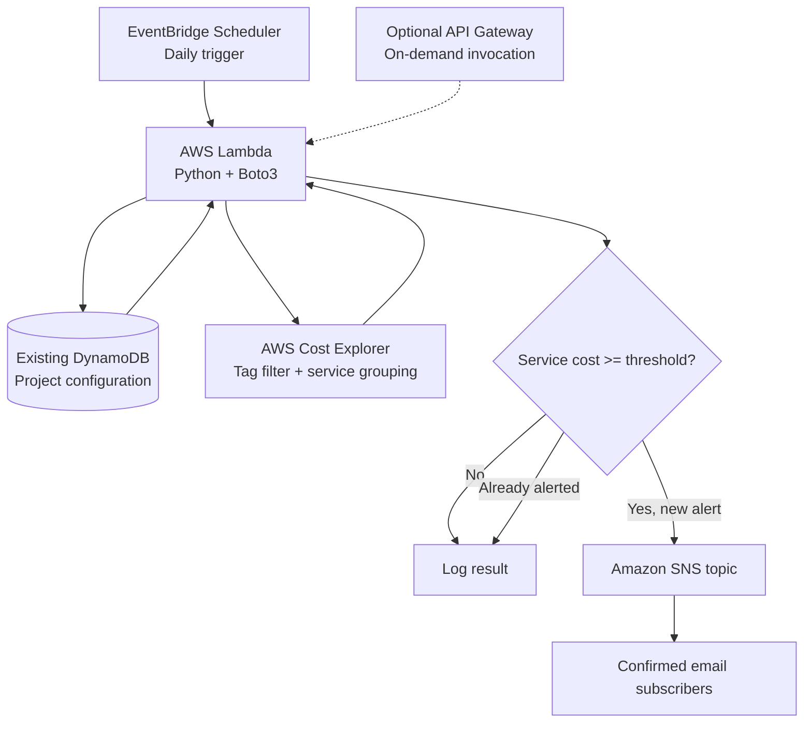

# AWS Project Cost Analyzer

**Serverless, project-level AWS cost monitoring and email alerts** using Python, AWS Lambda, AWS Cost Explorer, DynamoDB, Amazon SNS, and Amazon EventBridge Scheduler.

> **Status:** Proof of concept (POC). This repository describes a proposed implementation. Verify and test it in your AWS environment before describing it as deployed or production-ready.

## Overview

AWS Project Cost Analyzer checks **month-to-date spending for individual AWS services within a tagged project**. On a schedule, Lambda reads threshold settings from an existing DynamoDB configuration table, queries AWS Cost Explorer, compares each service's cost against its configured limit, and publishes an alert to an SNS topic with confirmed email subscribers.

**Example:** For project `DataPlatform-POC`, send an email when AWS Glue exceeds its $100 monthly threshold, without alerting on Redshift unless its separate $200 threshold is breached.

## Architecture



**SNS direction:** Lambda **publishes** to SNS. SNS is not a Lambda trigger in this design.

## AWS services

| Service | Purpose |
|---|---|
| AWS Lambda | Run cost evaluation logic |
| AWS Cost Explorer | Retrieve month-to-date costs grouped by service |
| Amazon DynamoDB | Existing table stores project configuration; optional alert state |
| Amazon SNS | Send threshold notifications to subscribed email addresses |
| EventBridge Scheduler | Invoke Lambda automatically |
| AWS IAM | Scope access to billing, configuration, and notifications |
| CloudWatch Logs | Log executions and errors |
| API Gateway (optional) | Expose an authenticated on-demand API |

## Project structure

```text
aws-project-cost-analyzer/
├── src/
│   └── cost_analyzer.py
├── config/
│   └── sample_config.json
├── infrastructure/
│   ├── main.tf
│   ├── variables.tf
│   └── outputs.tf
├── iam/
│   └── lambda_policy.json
├── tests/
│   └── test_cost_analyzer.py
├── docs/
│   └── architecture.md
├── .gitignore
├── requirements.txt
└── README.md
```

> The tree above is a **recommended layout**, not a claim that all files are already implemented. This README can be the first committed file.

## Prerequisites

- AWS account with permission to view Cost Explorer and configure Lambda, DynamoDB, SNS, IAM, and EventBridge Scheduler.
- Cost Explorer enabled and billing data available.
- Python 3.12 (or a currently supported Lambda Python runtime), Boto3, and optionally Terraform.
- An existing DynamoDB table with a string partition key named `project_id` (adapt the code if your schema differs).
- AWS resources consistently tagged, for example `Project=DataPlatform-POC`.
- Activate the `Project` **cost allocation tag** in AWS Billing and Cost Management. Tag reporting can take time to appear and may not fully cover historical charges.

## Configuration in DynamoDB

Example logical item in the existing `ProjectCostConfig` table:

```json
{
  "project_id": "DataPlatform-POC",
  "config": {
    "enabled": true,
    "tag_key": "Project",
    "tag_value": "DataPlatform-POC",
    "currency": "USD",
    "period": "MONTHLY",
    "thresholds": {
      "AWS Glue": 100,
      "Amazon Redshift": 200,
      "Amazon Simple Storage Service": 50,
      "AWS Lambda": 20
    }
  },
  "alert_state": {}
}
```

The `config` field can be a DynamoDB Map or a serialized JSON string if the Lambda supports both. **Use the exact service names returned by Cost Explorer**; names can differ from console branding. Keep all monetary comparisons in `Decimal`, not binary floating-point.

For a robust production design, store alert state in a **separate DynamoDB table** rather than growing the configuration item indefinitely.

## Environment variables

| Variable | Example | Description |
|---|---|---|
| `CONFIG_TABLE` | `ProjectCostConfig` | Existing DynamoDB table name |
| `DEFAULT_PROJECT_ID` | `DataPlatform-POC` | Project used for scheduled runs |
| `SNS_TOPIC_ARN` | `arn:aws:sns:ap-south-1:123456789012:aws-project-cost-alerts` | SNS topic to publish alerts |

The Cost Explorer API is accessed through its `us-east-1` endpoint. DynamoDB and SNS can use the Lambda's deployed AWS Region.

## Deployment steps

1. **Tag project resources.** Add the same `Project` tag value to resources belonging to this project, and activate the tag for cost allocation in Billing and Cost Management.
2. **Configure DynamoDB.** Insert a project item in the existing table using the schema above. Confirm its partition key and data types match the Lambda implementation.
3. **Create an SNS Standard topic.** Name it `aws-project-cost-alerts`, add an `Email` subscription, and click the confirmation link delivered to the recipient.
4. **Create a Lambda execution role.** Grant `ce:GetCostAndUsage`, `dynamodb:GetItem`, appropriate DynamoDB alert-state write access if enabled, `sns:Publish` on the topic, and CloudWatch Logs permissions. Limit DynamoDB and SNS resources to their ARNs.
5. **Deploy the Lambda.** Use Python, set the environment variables, and configure an appropriate timeout (for example, 60 seconds). Deploy outside a VPC unless private networking is required; if inside a VPC, ensure access to required AWS APIs.
6. **Test manually.** Invoke Lambda with a project ID and inspect its returned service costs, CloudWatch logs, DynamoDB state, and SNS notifications.
7. **Create an EventBridge Scheduler schedule.** Target the Lambda and configure a daily invocation. The Scheduler execution role needs `lambda:InvokeFunction` on the target. Add retry policy and a dead-letter queue where appropriate.
8. **Optional:** Add an authenticated API Gateway route for on-demand checks. Protect it using an appropriate authorizer; never expose unrestricted cost-query or threshold-edit endpoints.

### Example Scheduler settings

```text
Schedule expression: cron(0 9 * * ? *)
Timezone: Asia/Kolkata
Flexible time window: OFF
Target: AWS Lambda function
Input: {"project_id":"DataPlatform-POC"}
```

## IAM permissions

Illustrative Lambda permissions (replace Region, account, and resource names):

```json
{
  "Version": "2012-10-17",
  "Statement": [
    {
      "Effect": "Allow",
      "Action": ["ce:GetCostAndUsage"],
      "Resource": "*"
    },
    {
      "Effect": "Allow",
      "Action": ["dynamodb:GetItem", "dynamodb:UpdateItem"],
      "Resource": "arn:aws:dynamodb:ap-south-1:123456789012:table/ProjectCostConfig"
    },
    {
      "Effect": "Allow",
      "Action": ["sns:Publish"],
      "Resource": "arn:aws:sns:ap-south-1:123456789012:aws-project-cost-alerts"
    }
  ]
}
```

Also attach the AWS-managed `AWSLambdaBasicExecutionRole` policy for logs. If alert state is moved to a separate table, update permissions accordingly.

## Cost Explorer query approach

The Lambda uses `GetCostAndUsage` with:

- `TimePeriod.Start`: first day of the current UTC month.
- `TimePeriod.End`: **exclusive** end date, typically tomorrow's UTC date to include available data through today.
- `Granularity`: `MONTHLY`.
- `Metrics`: `UnblendedCost`.
- `Filter.Tags`: `Project=DataPlatform-POC`.
- `GroupBy`: `DIMENSION` / `SERVICE`.

Handle pagination (`NextPageToken`) when needed. Validate the returned currency/unit and use decimal arithmetic for comparisons.

**Important:** Cost Explorer is not real-time. Data can be delayed, and tags may not allocate every shared or untagged charge. Thresholds are alerts, **not spending caps**.

## Alert behavior

For each configured service:

1. Fetch the month-to-date project cost.
2. Compare it to the service threshold.
3. If cost meets or exceeds the threshold, check whether this threshold has already been notified for the current billing month.
4. If not, publish an SNS message containing project, service, actual cost, threshold, and utilization percentage.
5. Persist notification state and log the outcome.

**Example email**

```text
Subject: AWS Cost Alert - DataPlatform-POC

AWS PROJECT COST ALERT
Project: DataPlatform-POC

Service: AWS Glue
Current cost: $125.00
Monthly threshold: $100.00
Utilization: 125.0%

Review the AWS Billing and Cost Management console.
```

### Duplicate-alert reliability

A simple POC may use a DynamoDB conditional write to claim an alert before calling SNS. This helps avoid duplicates under concurrent executions, **but it has a failure gap**: if SNS publishing fails after the claim, retries may skip the alert. For production, implement a retryable `PENDING` / `SENT` state machine with recovery, or an outbox/queue pattern. SNS `Publish` success means SNS accepted the message, not that an email was delivered.

## Testing checklist

- [ ] Valid project configuration returns expected service costs.
- [ ] Disabled or unknown project is handled safely.
- [ ] Cost below threshold produces no alert.
- [ ] Cost equal to or above threshold triggers an SNS publication.
- [ ] Duplicate invocation does not generate repeated notifications.
- [ ] SNS publish failure can be retried without permanently losing the alert.
- [ ] Missing cost data and Cost Explorer pagination are handled.
- [ ] Missing/incorrect cost allocation tags are diagnosed.
- [ ] Lambda logs avoid credentials and sensitive billing data.
- [ ] Scheduler invokes the Lambda successfully.

Use mocked Boto3 responses for unit tests. Run an end-to-end test in a controlled AWS account before marking the POC complete.

## Security and cost considerations

- Never commit AWS credentials, `.env` files, Terraform state, private billing exports, or real account identifiers.
- Prefer IAM roles over static access keys.
- Restrict access to the configuration table and SNS topic.
- Add API authentication and authorization before exposing API Gateway routes.
- Monitor Lambda failures and Scheduler dead-letter messages.
- AWS Cost Explorer API requests may incur charges; verify current pricing before increasing check frequency.
- Project cost attribution depends on activated cost allocation tags and supported billing records.

## Roadmap

- [ ] Deploy the initial scheduled Lambda + DynamoDB + SNS POC.
- [ ] Add robust alert retry and idempotency handling.
- [ ] Add service-level 80%, 90%, and 100% alert levels.
- [ ] Add an overall project budget threshold.
- [ ] Add cost forecasting and historical trends.
- [ ] Add authenticated API Gateway endpoints.
- [ ] Add Terraform infrastructure and CI test automation.
- [ ] Add optional Cost and Usage Report (CUR) integration for finer-grained resource analysis.

## Portfolio relevance

This project demonstrates AWS serverless integration, Python/Boto3 automation, configuration-driven monitoring, cost allocation tags, IAM least privilege, event-driven scheduling, and FinOps fundamentals. When listing it on a CV, distinguish **implemented and tested features** from planned enhancements, and report measured results only when verified.

